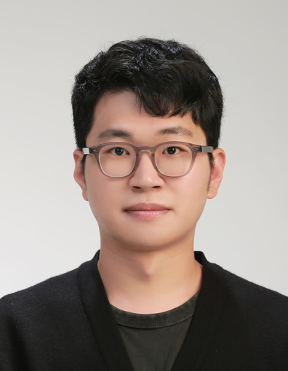

Jinsu Ra received his B.S. in Mechanical Engineering from Chung-Ang University (CAU), Seoul, South Korea, in 2025. He is currently pursuing his M.S. degree in Electrical Engineering (Future Vehicle) at KAIST, Daejeon, South Korea.

His research is driven by a longstanding goal of improving efficiency and productivity throughout engineering design and development. Originating from his hands-on experience in aircraft design and fabrication, this pursuit has guided his research from computational fluid dynamics (CFD) to AI-based surrogate modeling and, more recently, foundation models for engineering design. He is particularly interested in developing generalizable methodologies that leverage engineering domain knowledge to enhance design automation and decision-making.

His current research focuses on knowledge-grounded autonomous engineering design, leveraging large language models (LLMs), knowledge graphs and ontologies, and engineering data fusion.

----
